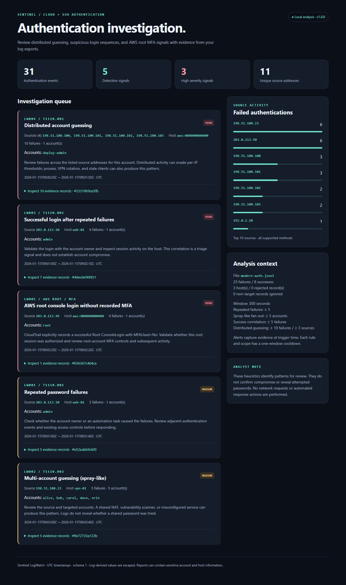
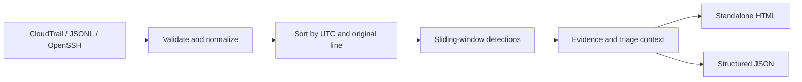

# Sentinel LogWatch

**Investigate cloud and SSH authentication abuse from local log exports.**

[](https://github.com/Hammad-Chughtai/LogWatch/actions/workflows/ci.yml)


[](LICENSE)

Sentinel LogWatch is a defensive Python CLI for investigating authentication activity in AWS CloudTrail, SSH logs, and normalized application events. Detect distributed guessing across IPs, spray-like account fan-out, successful logins after repeated failures, and AWS root console sign-ins recorded without MFA. Export a standalone HTML investigation report and structured JSON with traceable evidence.



## Try the demo

Requires Python **3.11 or newer**. No dependency installation is needed to run from the repository.

```bash
git clone https://github.com/Hammad-Chughtai/LogWatch.git
cd LogWatch
python -m sentinel_logwatch analyze examples/modern-auth.jsonl --strict --html report.html --json report.json
```

Open `report.html` in your browser. The fixture is entirely synthetic and uses documentation IP addresses.

```text
Sentinel LogWatch | 31 events | 23 failures | 8 successes
Alerts: 5 (3 high, 2 medium) | Rejected records: 0
[MEDIUM] LW001 203.0.113.50 -> 'web-01': Repeated password failures
[HIGH] LW004 198.51.100.101 -> 'aws:000000000000': Distributed account guessing
[HIGH] LW003 203.0.113.50 -> 'web-01': Successful login after repeated failures
[HIGH] LW005 203.0.113.99 -> 'aws:000000000000': AWS root console login without recorded MFA
[MEDIUM] LW002 198.51.100.23 -> 'vpn-01': Multi-account guessing (spray-like)
```

The generated [HTML example](docs/demo-report.html) and [JSON example](docs/demo-report.json) are included for inspection. Download the HTML file to view it; GitHub displays its source.

## Capabilities

- Configurable sliding-window detections across both individual and distributed sources, with distinct-account counting and per-scope cooldowns.
- An AWS CloudTrail adapter for direct IAM/root `ConsoleLogin` events, including explicit MFA evidence and account-scoped correlation.
- Investigation context: severity, source activity, affected accounts and hosts, triage guidance, and original log line numbers.
- Strict record validation, UTC and IP normalization, bounded input, and an offline HTML report with escaped log values.
- Deterministic JSON output, CLI exit codes for automation, 56 automated tests, and Windows/Linux CI.

## Analyze an AWS CloudTrail export

Download a CloudTrail JSON log file, decompress it if needed, and run:

```bash
python -m sentinel_logwatch analyze cloudtrail.json --format cloudtrail --strict --html cloud-report.html --json cloud-report.json
```

No AWS credentials, SDK, or cloud access is required. The adapter accepts a `{"Records": [...]}` envelope or one event object. It analyzes IAM/root `ConsoleLogin` records and counts unrelated service events and known federated identity types as ignored. Missing MFA evidence stays **unknown**. The root MFA rule requires an explicit `MFAUsed: "No"` and never infers upstream MFA state for federated sessions.

Try the included export with `examples/cloudtrail.json`: it contains a distributed guessing scenario and a root sign-in recorded without MFA, plus benign and out-of-scope events. Cloud evidence references `Records[0]` array positions, or `event` for a single-object input. See [cloud import details](docs/detection.md#cloudtrail-import).

## Detection rules

Default window: **300 seconds**, including both endpoints. Password, keyboard-interactive, and direct AWS console failures contribute to the guessing rules. Public-key failures are excluded.

| Rule | Signal | Default trigger | Severity | ATT&CK context |
| --- | --- | --- | --- | --- |
| LW001 | Repeated password failures | 5 failures for the same host, source IP, and account | Medium | [T1110.001](https://attack.mitre.org/techniques/T1110/001/) |
| LW002 | Multi-account guessing (spray-like) | 5 distinct accounts failing from one source IP on one host | Medium | [T1110.003](https://attack.mitre.org/techniques/T1110/003/) |
| LW003 | Success after repeated failures | A successful login after 5 failures for the same host, source IP, and account | High | [T1110.001](https://attack.mitre.org/techniques/T1110/001/) |
| LW004 | Distributed account guessing | 10 failures across at least 3 source IPs against one account on one host/AWS account | High | [T1110.001](https://attack.mitre.org/techniques/T1110/001/) |
| LW005 | AWS root console login without recorded MFA | A successful Root `ConsoleLogin` explicitly recording `MFAUsed: "No"` | High | Control review; no attack attribution |

ATT&CK links provide behavioral context, not a claim of certified detection coverage. Authentication logs do not contain attempted passwords: LW002 identifies fan-out that is compatible with spraying, enumeration, or other multi-account guessing. A success correlation is a reason to investigate, not proof of compromise. See [rule semantics and limitations](docs/detection.md).

## Input formats

Use `--format auto` (default), `jsonl`, `openssh`, or `cloudtrail`. Auto mode chooses between JSONL and OpenSSH per line; CloudTrail documents require `--format cloudtrail`.

**JSON Lines:** one object per line; `method` is optional and defaults to `password`.

```json
{"timestamp":"2026-01-15T09:00:00Z","host":"web-01","user":"alice","source_ip":"203.0.113.10","outcome":"failure","method":"password"}
```

| Field | Accepted values |
| --- | --- |
| `timestamp` | ISO 8601 date and time with seconds and `Z` or an explicit `±HH:MM` offset; optional fractional seconds |
| `host`, `user` | Nonempty printable strings, at most 255 characters; case-sensitive |
| `source_ip` | IPv4 or IPv6, without a zone identifier |
| `outcome` | `failure` or `success` |
| `method` | `password`, `publickey`, `keyboard-interactive`, or `aws-console` |
| `mfa_used` | Optional `true`, `false`, or `null`; omission means unknown |
| `identity_type` | Optional `Root` or `IAMUser`, only with `method: "aws-console"` |

Unknown fields and duplicate JSON keys are rejected. Do not include passwords, tokens, or other secrets in input records.

**OpenSSH:** timestamped `Failed` and `Accepted` authentication lines from `sshd` or `sshd-session`.

```text
2026-01-15T09:00:00Z web-01 sshd[42]: Failed password for invalid user alice from 203.0.113.10 port 50100 ssh2
2026-01-15T09:01:00+00:00 web-01 sshd[43]: Accepted publickey for alice from 203.0.113.10 port 50101 ssh2
```

```bash
python -m sentinel_logwatch analyze examples/openssh.log --format openssh --strict --html report.html
```

Traditional yearless syslog (`Jan 15 09:00:00 ...`), unrelated service messages, and unrecognized authentication formats are rejected. The tool does not guess a year or time zone. Normalize those records to the JSONL schema first.

## Tune thresholds and use in automation

```bash
python -m sentinel_logwatch analyze examples/auth.jsonl --config config.example.toml --strict --fail-on high --json report.json
```

```toml
[detection]
window_seconds = 300
brute_force_threshold = 5
spray_user_threshold = 5
success_failure_threshold = 5
distributed_failure_threshold = 10
distributed_source_threshold = 3
```

All settings must be positive integers. Windows are capped at 86,400 seconds; thresholds at 200,000. Output directories must already exist. Report files at the supplied output paths are replaced; input and configuration paths are protected against direct overwrite.

| Exit code | Meaning |
| --- | --- |
| `0` | Analysis completed; the selected `--fail-on` threshold was not met |
| `1` | Analysis completed and an alert met `--fail-on`; requested reports are still written |
| `2` | Invalid arguments, configuration, input, or output; also any rejected line with `--strict` |

Without `--strict`, unsupported lines are skipped and counted, a warning is printed, and reports show diagnostics. Use `--strict` in pipelines where partial input is unacceptable. An input with no valid events always exits `2`.

## Install the CLI (optional)

```bash
python -m venv .venv
# Linux/macOS: source .venv/bin/activate
# Windows PowerShell: .\.venv\Scripts\Activate.ps1
python -m pip install .
sentinel-logwatch --version
sentinel-logwatch analyze examples/auth.jsonl --html report.html
```

The CLI has zero runtime dependencies. Building/installing the package uses setuptools through pip and may download build tools.

## Development

```bash
python -m unittest discover -s tests -v
python tools/generate_demo.py
python -m sentinel_logwatch analyze examples/modern-auth.jsonl --strict --html docs/demo-report.html --json docs/demo-report.json
```

Tests cover threshold boundaries, host/account/source isolation, distributed sources, expired windows, cooldowns, public-key handling, UTC offsets, IPv6, cloud identities and MFA, malformed records, oversized input, bounded diagnostics, HTML escaping, CLI exit codes, and equivalent input formats.



Source modules are in `sentinel_logwatch/`; fixtures in `examples/`; tests in `tests/`. Read [CONTRIBUTING.md](CONTRIBUTING.md) before proposing changes and [SECURITY.md](SECURITY.md) for security reporting.

## Scope

This is an offline triage utility for small to medium log exports, not a streaming SIEM. It loads and sorts up to 200,000 accepted line-based events in memory and caps each logical text line at 65,536 characters. CloudTrail JSON is limited to 32 MiB and 200,000 total records. It does not scan networks, attempt logins, query threat feeds, geolocate addresses, or take response actions. Reports preserve account names, AWS account IDs, hosts, and IP addresses; review them before sharing.

**Hammad Chughtai** · [MIT License](LICENSE)
